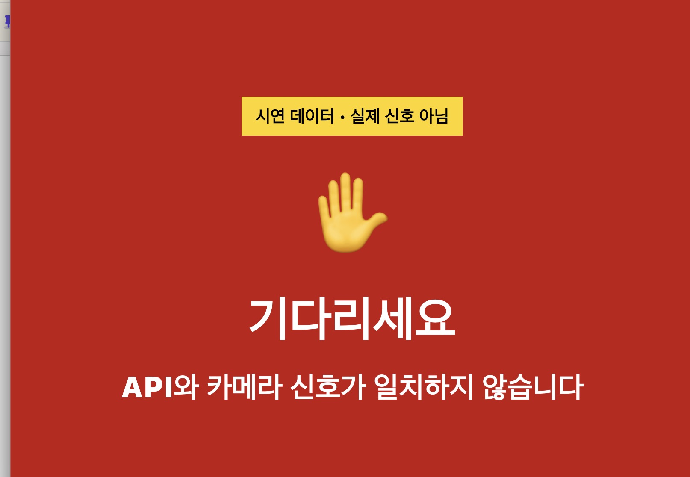
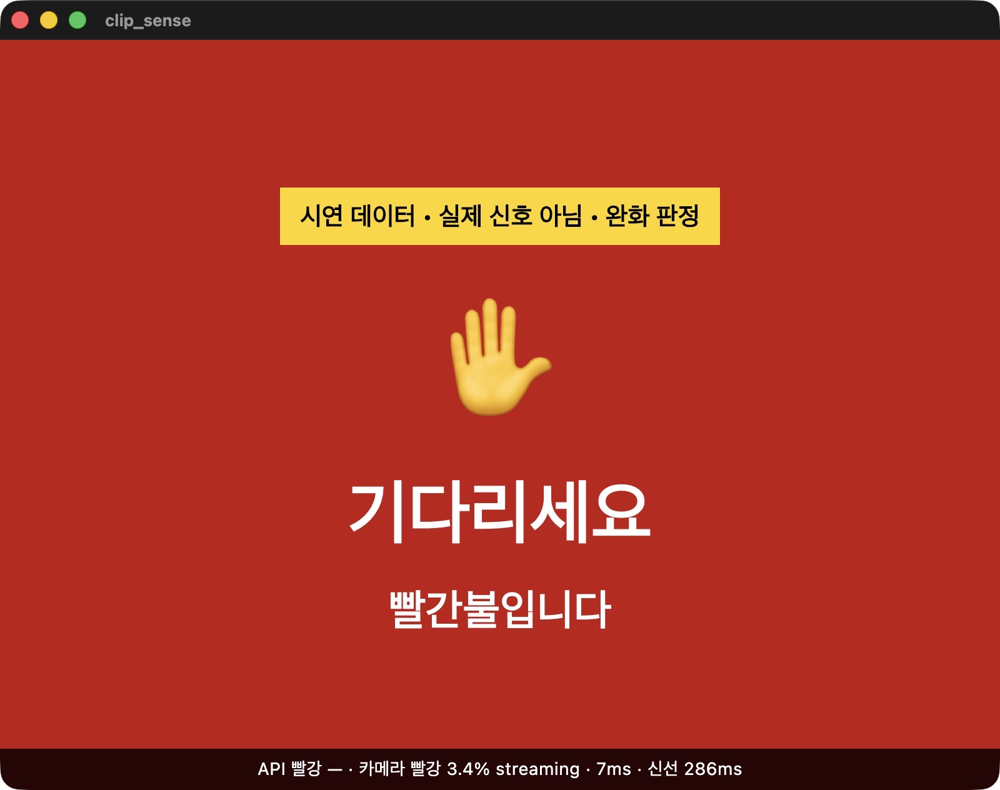
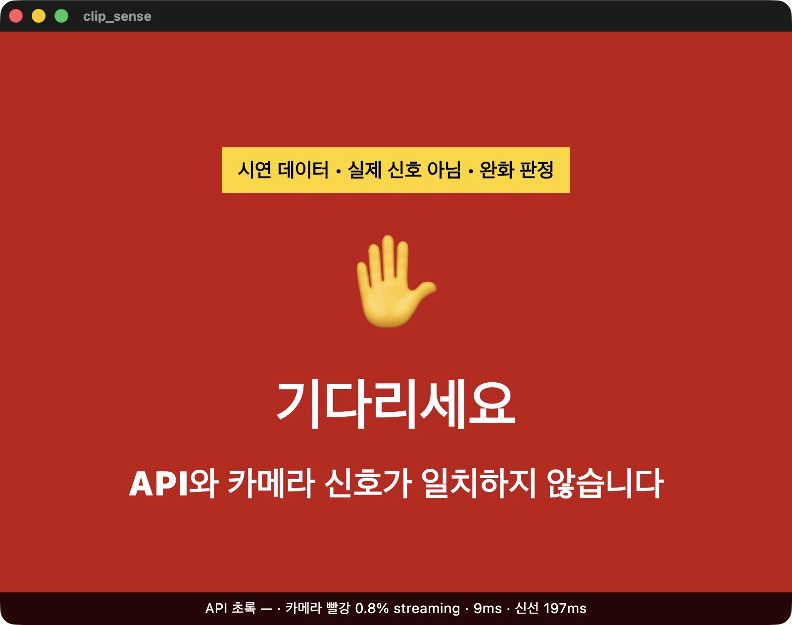
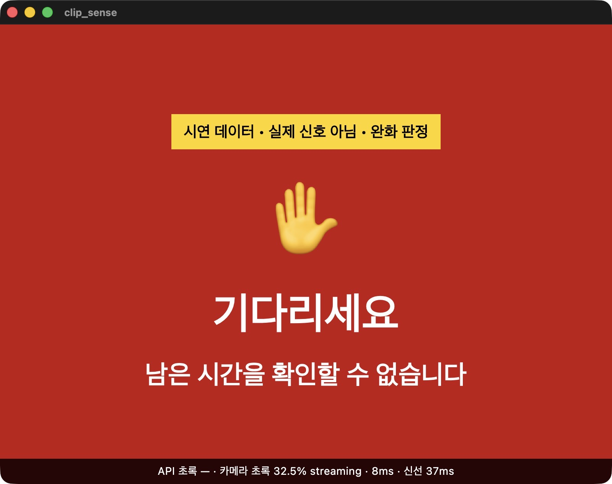

# 2026-10-12 카메라 입력 확인 · 신호 색 → 음성 실험

> 팀 입 닫고 빵이나 먹어 · 다림(임채환) SW · 폴(이유찬) 카메라·실물·기록
> 액션플랜 04 · 05 · 06 기록. 실제 도로 시험이 아니라 **테스트 입력 + 시연 신호**로 한 실험입니다.

## 한 줄 결론

카메라는 정상이었고, 막힌 곳은 판독 규칙이었다. 시험용으로 판정 기준을 완화하자, 둘 다 초록이어도 **남은 시간을 지어내지 않고 기다리게** 했다.

## 실험 환경

| 항목 | 내용 |
| :-- | :-- |
| 계획했던 장치 | 휴대폰 앱 → 앱 설치에 보호자 동의가 필요해 설치하지 못함 |
| 실제로 쓴 장치 | 맥북 카메라 → 카메라 서버(`scripts/clip_cam_sim.py --webcam`, 클립 카메라와 같은 통신 규약) → 실제 앱(맥 빌드) |
| 신호 | `DEMO_SIGNAL=color` — 초록 30초 ↔ 빨강 20초, **색만 주고 남은 시간은 없음** |
| 카메라 입력 | 폰 화면에 띄운 보행 신호등 사진 (테스트 입력) |
| 빌드 | `--dart-define=DEMO_SIGNAL=color --dart-define=CLIP_DEBUG=true --dart-define=LOOSE_DETECT=true` (기본 판정은 `LOOSE_DETECT` 없이) |

## 04. 카메라 입력 단계 확인

| 단계 | 관찰 | 판단 |
| :-- | :-- | :-- |
| ① 장치 연결 | 카메라 서버가 켜지고 앱이 장면을 계속 받아 감 (`GET /capture 200`) | 정상 |
| ② 화면 | 노트북 카메라가 실시간으로 찍음(320×240). 앱은 가운데 1/4(80×60)만 판독 | 정상 |
| ③ 소프트웨어 | 초록 사진을 대도 "API와 카메라 신호가 일치하지 않습니다"에서 바뀌지 않음 | 막힘 |

판독 기록 179장(0.7초 간격, 기본 판정): 빨강 79 · 색 없음 66 · **너무 커서 버림 22** · 밝기 급변으로 버림 12.
초록을 가까이 대자 판독 영역의 67~97%를 덮어, "60% 넘는 덩어리는 신호등이 아님"(`maxAreaRatio` 0.6) 규칙에 걸렸다.

## 05. 신호 색 → 음성 실험 (바꾼 조건: 판정 기준 기본 → 완화)

| | 기본 | 완화 (`LOOSE_DETECT`, 시험용) |
| :-- | :-- | :-- |
| 규칙 | 60% 넘는 덩어리 버림 · 밝기 급변 버림 · 같은 색 8번 연속 | 큰 덩어리 받음 · 밝기 급변 끔 · 4번 연속 (색 범위·판정 원칙 그대로) |
| 결과 | 가까이 댄 초록을 버림 → 계속 "일치하지 않습니다" | 빨강·불일치·초록이 각각 다른 안내로 나옴 |

앱 화면 53장(1.5초 간격)의 순서: 준비 중 → 빨간불입니다 ×2 → 일치하지 않습니다 ×7 → **남은 시간을 확인할 수 없습니다 ×6** → 일치하지 않습니다 ×2 → 빨간불입니다

| 둘 다 빨강 | 시연 초록 · 카메라 빨강 | 둘 다 초록 |
| :-: | :-: | :-: |
|  |  |  |
| "빨간불입니다" | "일치하지 않습니다" | "남은 시간을 확인할 수 없습니다" |

- 출처 없는 남은 시간 주장 없음: 둘 다 초록이어도 대기
- 정보가 부족하면 대기: 남은 시간 없음·카메라 준비 중·불일치 모두 "기다리세요"
- 하지 않은 것: 카메라 서버를 일부러 끊는 시험

## 06-1. 사실과 가설

| 영역 | 관찰한 사실 | 원인 가설 (단정하지 않음) |
| :-- | :-- | :-- |
| 입력 | 휴대폰 설치 불가(보호자 동의). 맥북 카메라 장면은 실시간 전달 | 판독 영역이 작아 조금만 옆으로 대도 영역 밖으로 나갈 수 있다 |
| 색 | 기본 판정은 가까이 댄 초록을 버림. 얼굴·손이 보이는 장면을 빨강으로 읽음(연속 5장 중 4장). 완화 판정은 초록 32.5%·빨강 3.4%를 맞게 읽음. 꽉 채워도 최대 85.9%는 가장자리 처리 때문(재현 확인) | 피부·붉은 물체가 빨강 색 범위에 들어간다. "너무 큼" 규칙은 실제 거리용이다 |
| 음성 | 상황마다 다른 이유를 말함. "건너세요" 0번 (화면 문구로 확인) | 시연 신호가 실제 신호등과 따로 바뀌어 "불일치"가 길게 나온다 |
| 끊김 | 남은 시간 없음·준비 중·불일치 때 모두 대기. 처음 실행 때 "확인 불가" 1회(원인 미확인) | 카메라 연결 전 상태였을 수 있다 → 서버를 끊는 시험으로 구분 |
| API | 오늘은 실제 API 미사용. 10/1 실호출에서 5분에 1번·약 30분 전 데이터 확인 | 실제 API로 바꾸면 늘 "오래됨"이 되어 계속 대기할 것이다 |

## 06-2 · 06-3. 사용자 장면과 다음 실험

- **도움받을 장면** — 음성신호기가 없는 횡단보도(상황 A). 신호 데이터와 카메라가 둘 다 초록이고 최신이며 남은 시간이 충분할 때만 안내하고, 아니면 이유를 말하며 대기한다.
- **아직 위험한 장면** — 신호등이 없는 이면도로(상황 B). 지금은 신호등만 읽기 때문에 차량 접근을 판단하지 못한다. 차량 탐지·추적은 별도 개발 항목이다.
- **아직 불편한 장면** — 신호등이 없는 장면을 빨강으로 읽어 초록불에서도 계속 기다리게 될 수 있다.
- **다음 실험** — 정답을 미리 적어 둔 주간 보행 신호등 장면 20장(빨강 10·초록 10)으로 인식 정확도(맞힌 장 ÷ 20 × 100)를 잰다.

두 상황의 상세 설계(시험 장면 A-1~A-7·B-1~B-7, 측정 지표, 안전·윤리)는 다림·폴이 작성한 「ClipSense 상세 가상 상황 및 실험 설계」에 있다.

## 추가 확인 (2026-10-15) — 실제 API를 앱 판정으로 해석

`scripts/probe_signal_api_live.py`로 서울 T-Data 실서버를 1회 호출했다.

| 항목 | 결과 |
| :-- | :-- |
| 응답 | HTTP 200 · 왕복 263ms · 교차로 1537 · 레코드 10개 |
| 데이터 나이 | 전송시각 기준 **1168.6초(약 19.5분)** |
| 앱 판정 계층 해석 | `color=UNKNOWN remain=None` — 2초보다 오래되어 쓰지 않음 → **대기** |

실제 API가 오래된 데이터를 줄 때 앱이 그것을 최신 신호처럼 쓰지 않는다는 것을 실서버로 확인했다. 실시간 안내는 실시간 API(`v2xSignalPhaseTimingFusionCurrentInfo`) 승인 뒤에 검증한다.

## 아직 검증하지 못한 것

| 항목 | 막힌 이유 | 필요한 것 |
| :-- | :-- | :-- |
| 클립 카메라 실기기 | 확장 보드 분리·버튼 고장·USB 데이터 미인식 | 데이터 전송용 USB-C 케이블, 확장 보드 재장착 후 펌웨어 업로드 |
| 실시간 신호로 보행 안내 | 기존 API가 5분 1회·약 30분 지연 | 실시간 API 활용 신청·승인 |
| 실제 횡단보도 · 당사자 사용 | 위 두 항목 선행 | 안전 계획 수립 후 진행 |

분석에 쓴 카메라 장면(얼굴 포함)은 분석 직후 삭제했고, 이 문서에는 앱 화면만 남겼다.
