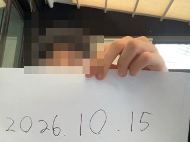
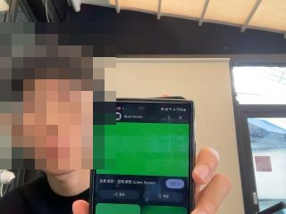
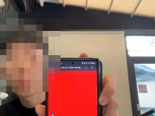

# 2026-10-15 새 보드 인식 · 카메라 진단 · 노트북 촬영 중계

> 팀 입 닫고 빵이나 먹어 · 다림(임채환) 2·3번(보드·업로드·수신·웹 경로) · 폴(이유찬) 1번(회고 대조·분담)
> 보드 Seeed XIAO ESP32-S3 Sense · 카메라 OV3660 · 펌웨어 ClipSense 0.2.0 → 0.3.0

## 한 줄 결론

보드는 전원·USB·업로드·Wi-Fi까지 정상이었지만, **클립 카메라는 대답하지 않아 실촬영은 하지 못했다.** 코치와 상의해 노트북 카메라로 찍은 사진을 **보드로 보내고 보드에서 다시 받는** 중계 방식으로 바꿨고, 사진 3장이 보드를 거쳐 그대로 돌아오는 것을 확인했다. 이 사진은 클립 촬영이 아니며, 보드가 응답마다 `X-Frame-Source: laptop-upload`, `X-Camera-Sensor: LAPTOP` 으로 표시한다.

## 다림이 정한 것

| 항목 | 결정과 이유 (다림) |
| :-- | :-- |
| 성공 기준 | 날짜 카드 글씨가 읽힌다 — 나중에 신호등의 잔여 시간을 읽을 수 있는지로 이어지기 때문 |
| 찍을 물체 | ① 날짜 카드(잔여 시간 숫자 판독을 내다봄) ② 폰 화면 빨강·초록(신호 색) ③ 계획은 신호등 이미지였으나 **"일단 색깔부터 보고 싶어서"** 빨강 화면으로 바꿈 |
| 연결 경로 | 폰 핫스팟 — 학교 Wi-Fi는 5GHz라 보드(2.4GHz 전용)가 붙지 못하고, 앱에서 Wi-Fi 정보를 보드로 넘기는 기능이 아직 없어서 |
| 업로드 순서 | 제조사 예제를 건너뛰고 ClipSense 펌웨어를 바로 올림 — "목표가 사진 받기라서 빠르게 테스트하고 문제를 빠르게 확인한 뒤 수정하기로 했다" |

## 2번 — 새 보드 인식 · 업로드 · 실촬영

| 단계 | 결과 | 근거 |
| :-- | :-- | :-- |
| 전원 | ✅ | 보드 LED 켜짐 |
| USB 인식 | ✅ (선 교체 후) | 처음엔 허브·카드리더만 보임 → **다림의 가설 "선 문제"** 로 선만 바꾸자 `USB JTAG_serial debug unit` 인식 |
| 업로드 | ✅ | ClipSense 펌웨어 0.2.0 업로드 · 부팅 로그 출력 |
| Wi-Fi | ✅ (핫스팟 2.4GHz 설정 후) | `networkMode STA`, 핫스팟에서 IP 받음, RSSI −33dBm |
| 실촬영 | ❌ | `Detected camera not supported` · `cameraOk false` ([부팅 로그](2026-10-15/bootlog_camera_failed.txt)) |

### 카메라 원인 좁히기 — 한 번에 하나씩 바꿈

| # | 바꾼 것 | 결과 |
| :-- | :-- | :-- |
| 1 | 카메라 모듈 (같은 종류 여러 개) | 모두 무응답 |
| 2 | 리본 다시 꽂기 | 무응답 |
| 3 | 진단 프로그램([`firmware/tools/camera_probe`](../../firmware/tools/camera_probe/camera_probe.ino)): XCLK 20MHz 출력 확인, SDA·SCL 대기 상태 1, I2C 주소 전체 스캔 | **XCLK 정상 · 통신선 정상 · 카메라 무응답** ([결과](2026-10-15/camera_probe.txt)) |
| 4 | 보드 교체 (10/2 원래 보드) | 같은 선으로도 USB 미인식 → 원래 보드 USB 불량 의심 |
| 5 | 확장 보드 다시 끼우기 | 무응답 |
| 6 | 새 보드 + 새 카메라 (오후) | 맥에서 USB로 잡히지 않아 카메라까지 확인하지 못함 |

**판단 (다림)**: 카메라를 바꿔도, 리본·확장 보드를 다시 끼워도 같다 → 문제는 카메라가 아니라 **확장 보드(카메라 커넥터·전원) 또는 확장 보드와 본체 사이 연결**. 다음 실험은 다른 확장 보드로 교체.

> 진단 중 판단 실수: 처음엔 펌웨어의 "not supported"와 진단의 "응답 없음"이 서로 다르다고 보고 진단 도구를 의심했다. 클럭 출력과 통신선 상태를 함께 찍게 고친 뒤, 둘 다 "카메라가 대답하지 않음"을 뜻한다고 정리했다.

## 3번 — 사진 수신 · 웹 연결 (노트북 촬영 중계)

### 구조 (펌웨어 0.3.0)

```
노트북 카메라 ──POST /frame──▶ 보드 ◀──GET /capture── 노트북·앱·웹
                               (카메라가 정상이면 항상 카메라 우선)
```

- 업로드 프레임은 응답마다 `X-Frame-Source: laptop-upload` · `X-Camera-Sensor: LAPTOP` 을 붙인다.
- 업로드가 성공할 때만 `X-Frame-Seq` 가 1 증가한다.
- 5초보다 오래된 업로드 프레임은 내주지 않는다(`503 no_recent_frame`) — 정지 화면을 새 프레임처럼 보내지 않기 위해.
- 토큰이 없으면 401, 틀리면 403.
- 중계 통계는 `GET /relay`(토큰 필요)로 본다. 실험 당시 빌드(16:11)는 이 값을 `/health`에 덧붙였으나, `/health` 26개 키 계약(시뮬레이터·검사기와 동일)을 지키려고 저장소 코드는 `/relay`로 옮겼다.

### 3회 수신 기록 ([전체 기록](2026-10-15/relay_log.jsonl))

| # | 시각 | 찍은 것 | `X-Frame-Seq` | 출처 | 보낸 것과 같음 | 왕복 |
| :-: | :-- | :-- | :-: | :-- | :-: | --: |
| 1 | 16:17:54 | 날짜 카드 "2026.10.15" | 2 | laptop-upload · LAPTOP | ✅ | 220ms |
| 2 | 16:18:03 | 폰 화면 초록 | 3 | laptop-upload · LAPTOP | ✅ | 413ms |
| 3 | 16:18:13 | 폰 화면 빨강 | 4 | laptop-upload · LAPTOP | ✅ | 324ms |

`X-Frame-Seq` 1은 연결 확인용 시험 이미지("LINK TEST", 카메라 사진 아님)다. 세 사진은 서로 다른 파일이며(md5 상이), 보드에서 받은 바이트가 보낸 바이트와 같았다. 날짜 카드는 320×240에서도 **사람 눈으로** 읽힌다 — 앱의 숫자 자동 판독은 아직 확인하지 않았다.

| 날짜 카드 (seq 2) | 초록 (seq 3) | 빨강 (seq 4) |
| :-: | :-: | :-: |
|  |  |  |

사진의 얼굴은 공개 저장소용으로 모자이크했다(원본은 로컬 보관).

### 웹 연결 구성 (비밀값 제외)

| 항목 | 내용 |
| :-- | :-- |
| 경로 | 폰 핫스팟(2.4GHz) 안에서 노트북 ↔ 보드 (`clipsense-0000.local`) |
| 사진 보내기 | `POST /frame` multipart, 헤더 `X-Clip-Device-Token` |
| 사진 받기 | `GET /capture`, 헤더 `X-Clip-Device-Token` (401/403 확인함) |
| 웹 페이지 | `https://localhost:5173` (개발 서버가 HTTPS). https 페이지는 http 보드에 바로 요청할 수 없어(혼합 콘텐츠), 개발 서버 프록시 `/board/capture`를 거친다 — [PR #1](https://github.com/WayMakerSchool/2026-ClipSense-CloseYourMouthandeatBread/pull/1)(폴, 비교 대기·미병합). GitHub Pages는 프록시가 없어 사용 불가 |
| 버전 | 펌웨어 0.3.0 · 도구 `scripts/laptop_frame_relay.py` |

## 아직 하지 못한 것

| 항목 | 이유 | 다음 |
| :-- | :-- | :-- |
| 클립 카메라 실촬영 | 카메라 무응답(확장 보드 의심) | 다른 확장 보드로 교체 |
| 웹 화면에서 보드 사진 표시 | 폴 PR #1: 시뮬레이터로 프록시 경유 수신·토큰 401/403·출처 표시 확인, CI·웹 테스트 399개 통과. 실제 보드·브라우저 화면 미확인 | 다림 브랜치 결과와 비교(10/22) 후 하나만 병합 |
| 앱의 색·숫자 판독 | 오늘은 수신까지 | 중계 사진으로 판독 시험 |
